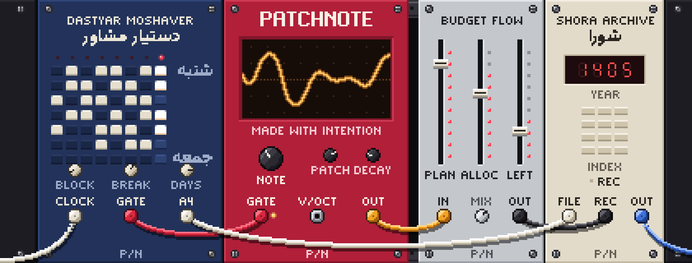
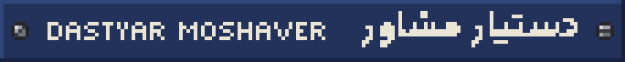
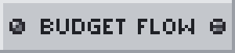
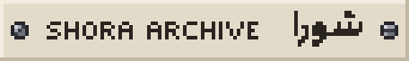
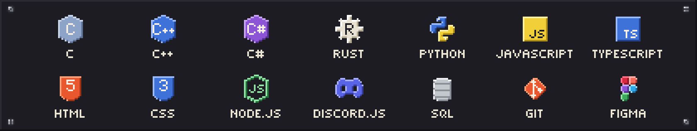
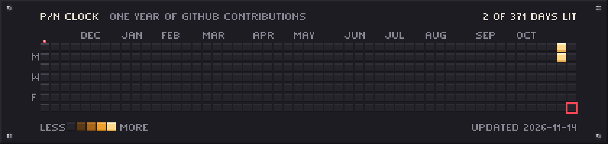

<a href="./README.md">English</a>

<picture>
  <source media="(max-width: 600px) and (prefers-reduced-motion: reduce)" srcset="./assets/rack-compact.png">
  <source media="(max-width: 600px)" srcset="./assets/rack-compact.gif">
  <source media="(prefers-reduced-motion: reduce)" srcset="./assets/rack.png">
  
</picture>

# مانی / PatchNote

نرم‌افزار، رابط کاربری و سیستم‌های بصری می‌سازم و به جزئیاتی اهمیت می‌دهم که به یک محصول حس کامل‌بودن می‌دهند.

کارم میان مهندسی، طراحی بصری و نوشتن در رفت‌وآمد است و همیشه به موسیقی، عکاسی، کتاب، ریاضیات، فیزیک و فضا برمی‌گردد. باقی‌اش در **[patchnote.top](https://patchnote.top/)** است.

## یادداشت‌های به‌روزرسانی، آبان ۱۴۰۵

- **تغییر نام.** برنامه‌نگار حالا دستیار مشاور است.
- **تازه.** همین پروفایل، که از نو به شکل یک سینتی‌سایزر ماژولار ساخته شده، با یک ماژول برای هر پروژه.
- **مشکل شناخته‌شده.** نسخهٔ نمایشی عمومی آرشیو شورا خبر می‌دهد که سرورش در دسترس نیست.

## کارهای برگزیده

 
یک برنامه‌ریز درسی برای ویندوز و macOS. بلوک‌های مطالعه را حساب می‌کند، برنامهٔ هفتگی را می‌چیند و آن را روی یک برگهٔ A4 یا به‌صورت PDF چاپ می‌کند. همه‌چیز روی رایانهٔ خودتان می‌ماند.

 
یک فضای برنامه‌ریزی برای بودجه‌ها، اهداف خرید، مهمان‌ها، چک‌لیست‌ها، مرجع محصولات، نظرسنجی‌ها و یادداشت‌ها.

 
دفتر مکاتبات یک شورای دانش‌آموزی: هر نامه ثبت، نمایه‌گذاری و جست‌وجوپذیر شده است.

 
گوشهٔ خودم در وب، برای توسعه، آزمایش‌های رابط کاربری، کارهای بصری و نوشتن.

## تجربه

**PineApple Craft.** توسعهٔ وب‌سایت و سرور، مدیریت سرورهای بازی، و بات‌ها و پلاگین‌های سفارشی دیسکورد.

**The Dirt House Community.** توسعهٔ رابط کاربری و ابزارهای جامعه: پلاگین‌ها، بات‌ها و ابزارهای مدیریت سرور.

**Phoenix Client.** وب‌سایتی برای معرفی خدمات و محصولاتش، و توسعهٔ بات دیسکورد.

این‌ها کارهای سفارشی و جامعه‌محورند، برای همین هیچ‌کدام در مخزن‌های عمومی این حساب نیستند.

## ابزارها

<picture>
  <source media="(max-width: 600px)" srcset="./assets/tools-compact.png">
  
</picture>

## امسال، به شکل یک سکوئنسر

<picture>
  <source media="(max-width: 600px) and (prefers-reduced-motion: reduce)" srcset="https://raw.githubusercontent.com/PatchNote0/PatchNote0/output/sequencer-compact.png">
  <source media="(max-width: 600px)" srcset="https://raw.githubusercontent.com/PatchNote0/PatchNote0/output/sequencer-compact.gif">
  <source media="(prefers-reduced-motion: reduce)" srcset="https://raw.githubusercontent.com/PatchNote0/PatchNote0/output/sequencer.png">
  
</picture>

هر پد یک روز از مشارکت‌های عمومی من در گیت‌هاب است و روزهای پرکارتر روشن‌ترند. هر روز خودش را از نو می‌کشد.

 

  <picture></picture>

با نیت ساخته شده. جزء به جزء صیقل خورده.

