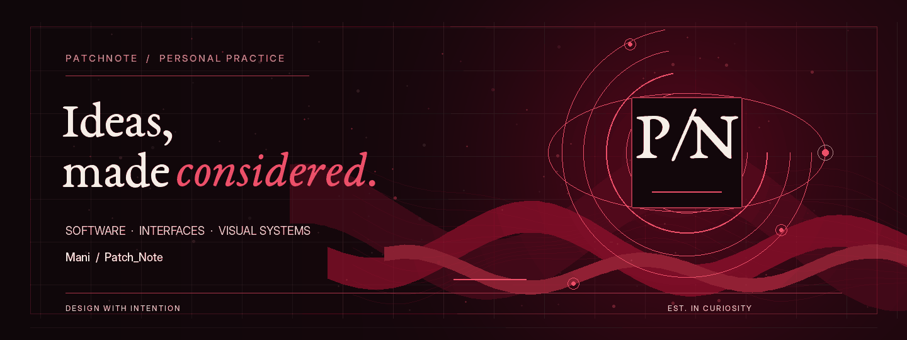
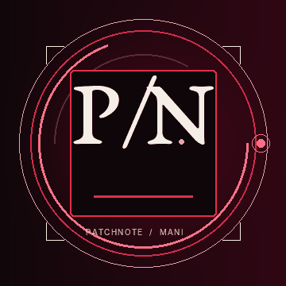
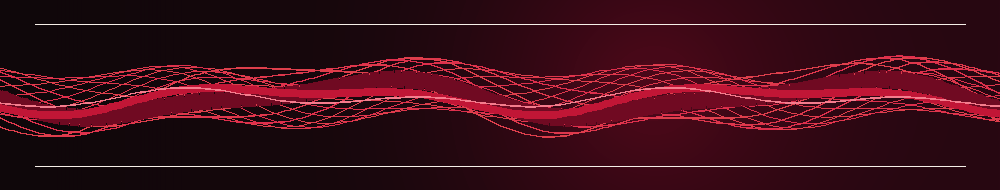
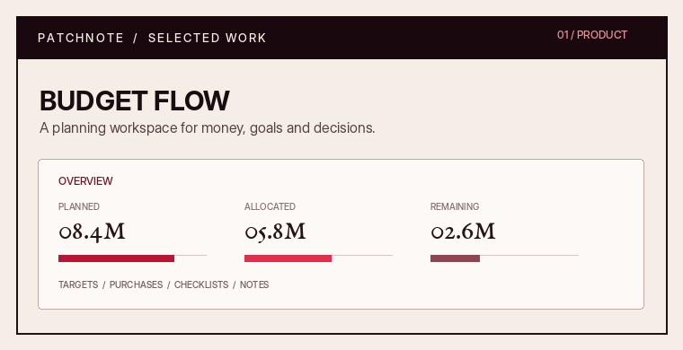
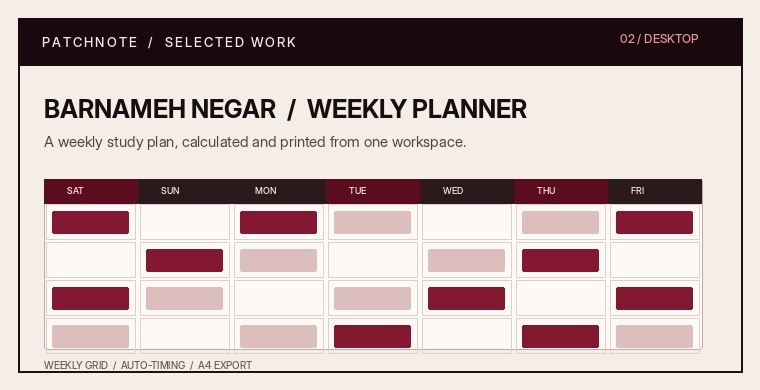
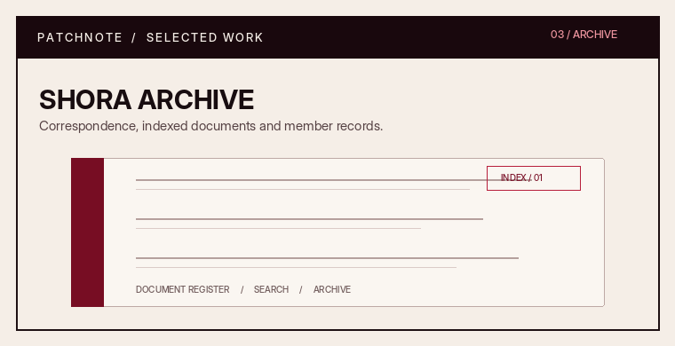
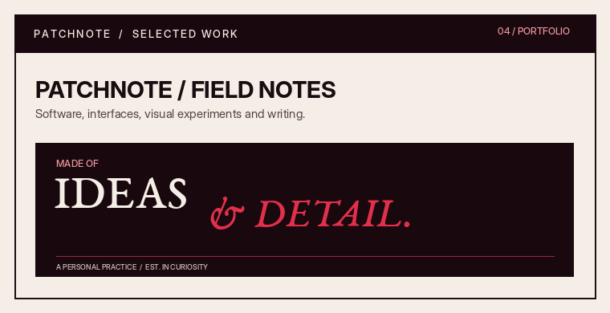

  
   
  
  <h1>MANI / PATCH_NOTE</h1>
  
<em>Software, interfaces &amp; visual systems.</em>

  

    <a href="https://patchnote.top/">WEBSITE</a>
    &nbsp;·&nbsp;
    <a href="https://github.com/PatchNote0">GITHUB</a>
    &nbsp;·&nbsp;
    <a href="https://patchnote.top/">SELECTED WORK</a>
  

---

## 01 / A practice between code and composition

I build useful software, shape interfaces, and care about the details that make a product feel complete. My work moves between engineering, visual design, writing, and the small experiments that connect them.

I am especially interested in thoughtful UI, practical desktop and web tools, custom interactions, music, photography, books, mathematics, physics, and space.

  

## 02 / Selected work

<table>
  <tr>
    <td width="50%" valign="top">
      
      <h3>Budget Flow</h3>
      
A planning workspace for budgets, purchase goals, guests, checklists, product references, polls, and notes.

      
<a href="https://patchnote.top/budgetflow-pn/bf-index.html">EXPLORE PROJECT ↗</a>

    </td>
    <td width="50%" valign="top">
      
      <h3>برنامه‌نگار / Barnameh Negar</h3>
      
A Windows and macOS study-planning tool. It calculates study blocks, builds weekly schedules, and exports A4 sheets or PDFs. Data stays on the user's computer.

      
<a href="https://patchnote.top/barnameh-negar.html">EXPLORE PROJECT ↗</a>

    </td>
  </tr>
  <tr>
    <td width="50%" valign="top">
      
      <h3>Shora Archive</h3>
      
A correspondence-book interface for a student council, with document indexing and search. The public demo currently reports that its server is unavailable.

      
<a href="https://patchnote.top/shora/">VIEW DEMO ↗</a>

    </td>
    <td width="50%" valign="top">
      
      <h3>PatchNote</h3>
      
A personal corner for development, interface experiments, visual work, and writing.

      
<a href="https://patchnote.top/">VISIT WEBSITE ↗</a>

    </td>
  </tr>
</table>

## 03 / Experience

**PineApple Craft** — Website and server development, game-server management, custom Discord bots, and plugins.

**The Dirt House Community** — Interface development and community tools, including plugins, bots, and server-management utilities.

**Phoenix Client** — Website work for presenting services and products, alongside Discord bot development.

These are portfolio experiences described on my website; they are not presented as public repositories owned by this GitHub account.

## 04 / Tools in the workshop

`HTML` &nbsp; `CSS` &nbsp; `JavaScript` &nbsp; `Python` &nbsp; `C++` &nbsp; `C#` &nbsp; `Node.js` &nbsp; `Discord.js` &nbsp; `Git` &nbsp; `Figma`

A practical list of tools and languages I have worked with or explored — not a proficiency ranking.

## 05 / Motion, made with code

The moving artwork in this profile is generated frame by frame with Python and Pillow. The hero uses separate visual layers moving at different rates to create a parallax impression; the monogram and wave study are procedural animations, not third-party embeds.

  
  
FIELD STUDY  /  DEPTH, RHYTHM, REPETITION

---

  
<em>Made with intention. Refined one detail at a time.</em>

  <a href="https://patchnote.top/">PATCHNOTE.TOP</a>

