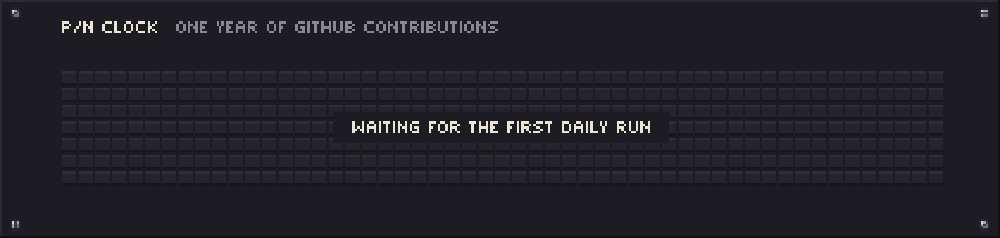

<a href="https://patchnote.top/">
  <picture>
    <source media="(prefers-reduced-motion: reduce)" srcset="./assets/rack.png">
    
  </picture>
</a>

# Mani / PatchNote

I build useful software, shape interfaces and care about the details that make a product feel complete. My work moves between engineering, visual design and writing, and keeps returning to music, photography, books, mathematics, physics and space. The rest lives at [patchnote.top](https://patchnote.top/).

## Patch notes, November 2026

- **Renamed.** Barnameh Negar is now Dastyar Moshaver, دستیار مشاور.
- **New.** This profile: a modular synth drawn in pixels by a Python script, with one module for each project.
- **Known issue.** The public demo of Shora Archive reports that its server is unavailable.

## Selected work

**[Dastyar Moshaver](https://patchnote.top/barnameh-negar.html)**<br>
A study planner for Windows and macOS. It works out study blocks, builds the weekly plan and prints it as an A4 sheet or a PDF. Everything stays on your own computer.

**[Budget Flow](https://patchnote.top/budgetflow-pn/bf-index.html)**<br>
A planning workspace for budgets, purchase goals, guests, checklists, product references, polls and notes.

**[Shora Archive](https://patchnote.top/shora/)**<br>
The correspondence book of a student council: every letter registered, indexed and searchable.

**[PatchNote](https://patchnote.top/)**<br>
My own corner of the web, for development, interface experiments, visual work and writing.

## Experience

**PineApple Craft.** Website and server development, game-server management, custom Discord bots and plugins.

**The Dirt House Community.** Interface development and community tools: plugins, bots and server-management utilities.

**Phoenix Client.** A website presenting its services and products, and Discord bot development.

This is client and community work, so none of it lives in public repositories on this account.

## Tools

HTML, CSS, JavaScript, Node.js, Python, C++, C#, Discord.js, Git and Figma.

## This year, as a sequence

<picture>
  <source media="(prefers-reduced-motion: reduce)" srcset="./assets/sequencer.png">
  
</picture>

Each pad is one day of my public GitHub contributions, brighter on busier days. A GitHub Action reads the calendar and redraws this every day.

<details>
<summary>How this profile is drawn</summary>
<br>

Every picture here is pixel art drawn by code in [`art/`](./art), with Python and Pillow. There are no image editors, no stats services and no third-party cards.

- [`art/rack.py`](./art/rack.py) draws the synth. The Dastyar Moshaver module is a study week read from right to left with Saturday at the top. Each lit block is a note: the PatchNote voice draws it on its scope, Budget Flow meters it and Shora Archive records it. The A4 output, the printed plan, is patched into the archive.
- [`art/sequencer.py`](./art/sequencer.py) draws the year above from GitHub's public contribution calendar, and [the workflow](./.github/workflows/sequencer.yml) runs it every day.
- [`art/fonts.py`](./art/fonts.py) holds the hand-drawn bitmap fonts. Persian is set in [Vazirmatn](https://github.com/rastikerdar/vazirmatn) and snapped to whole pixels.

To draw everything again:

```sh
pip install pillow
python art/rack.py && python art/extras.py && python art/sequencer.py
```

</details>

<br>

<p align="center">
  
</p>
<p align="center">Made with intention. Refined one detail at a time.</p>
