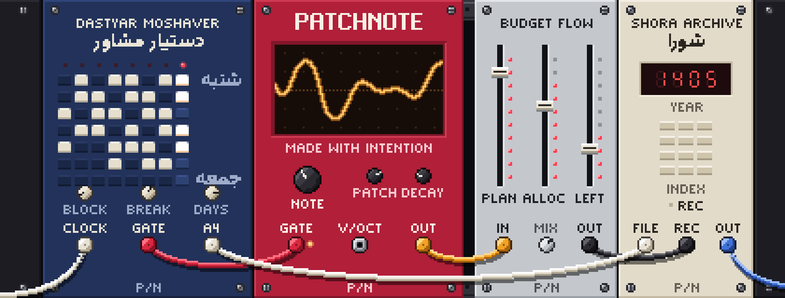
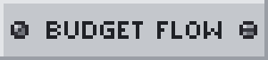
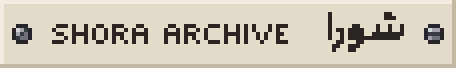
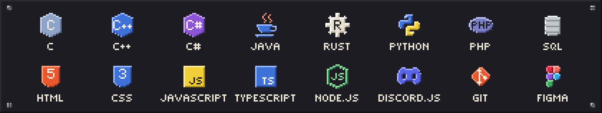
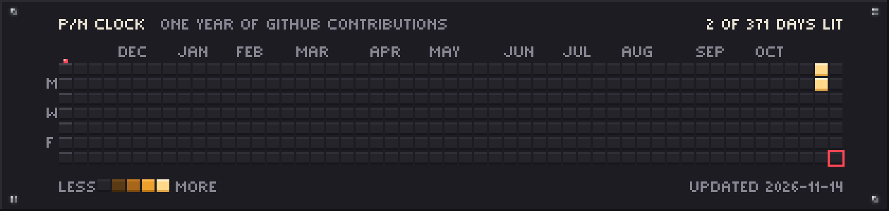

<picture>
  <source media="(max-width: 600px) and (prefers-reduced-motion: reduce)" srcset="./assets/rack-compact.png">
  <source media="(max-width: 600px)" srcset="./assets/rack-compact.gif">
  <source media="(prefers-reduced-motion: reduce)" srcset="./assets/rack.png">
  
</picture>

# Mani / PatchNote

I build software, interfaces and visual systems, and I care about the details that make a product feel complete.

My work moves between engineering, visual design and writing, and keeps returning to music, photography, books, mathematics, physics and space. The rest lives at **[patchnote.top](https://patchnote.top/)**.

## Patch notes, November 2026

- **Renamed.** Barnameh Negar is now Dastyar Moshaver, دستیار مشاور.
- **New.** This profile, rebuilt as a modular synth with one module for each project.
- **Known issue.** The public demo of Shora Archive reports that its server is unavailable.

## Selected work

 
A study planner for Windows and macOS. It works out study blocks, builds the weekly plan and prints it as an A4 sheet or a PDF. Everything stays on your own computer.

 
A planning workspace for budgets, purchase goals, guests, checklists, product references, polls and notes.

 
The correspondence book of a student council: every letter registered, indexed and searchable.

 
My own corner of the web, for development, interface experiments, visual work and writing.

## Experience

**PineApple Craft.** Website and server development, game-server management, custom Discord bots and plugins.

**The Dirt House Community.** Interface development and community tools: plugins, bots and server-management utilities.

**Phoenix Client.** A website presenting its services and products, and Discord bot development.

This is client and community work, so none of it lives in public repositories on this account.

## Tools

<picture>
  <source media="(max-width: 600px)" srcset="./assets/tools-compact.png">
  
</picture>

## This year, as a sequence

<picture>
  <source media="(max-width: 600px) and (prefers-reduced-motion: reduce)" srcset="https://raw.githubusercontent.com/PatchNote0/PatchNote0/output/sequencer-compact.png">
  <source media="(max-width: 600px)" srcset="https://raw.githubusercontent.com/PatchNote0/PatchNote0/output/sequencer-compact.gif">
  <source media="(prefers-reduced-motion: reduce)" srcset="https://raw.githubusercontent.com/PatchNote0/PatchNote0/output/sequencer.png">
  
</picture>

Each pad is one day of my public GitHub contributions, brighter on busier days. It redraws itself every day.

 

  <picture></picture>

Made with intention. Refined one detail at a&nbsp;time.

